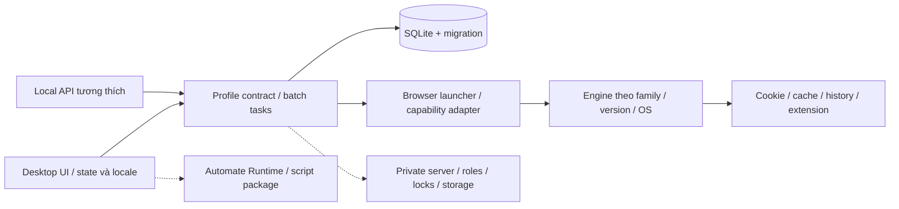

# Phân tích lại GPMLogin để tái dựng sát bản gốc

**Kết luận chính:** vòng này đã có đặc tả dữ liệu, nhãn và luồng vận hành tốt hơn rõ rệt so với bản Profile Studio 0.1. Tuy nhiên **0.1 chưa phải bản GPM tương đương**, và chưa có cơ sở gắn con số “giống 100%”. Để làm sát cần sửa hợp đồng dữ liệu/engine/hành vi, không chỉ đổi giao diện hoặc thêm các ô fingerprint.

Báo cáo dựa trên đúng bộ cài đã gửi, tài liệu công khai được website GPM dẫn đến và video Drive người dùng bổ sung. Không công bố video/transcript, thông tin tài khoản, license/proxy hoặc raw dump có thể chứa dữ liệu nhạy cảm. Báo cáo này không cập nhật hay tự phát hành một bản ứng dụng mới.

## 1. Đang đối chiếu ba phiên bản khác nhau

| Nguồn | Nhận diện | Dùng để làm gì |
| --- | --- | --- |
| Bộ cài người dùng gửi | `GPMLoginGlobal_setup_latest.exe`,596347040byte; SHA-256 `a6fe103fa5308721e0f611bc893cf4ff166e84eae763453622f6e8bd2c757943` | Chuẩn phân tích chính; tài nguyên tự khai **5.1.2-stable** |
| App chính đã trích | 100447536byte, SHA-256 `4395e4ed3a3548465c0f339f4e522ead0e9faa9adabb0dadcb73f63bd7a8688e`; NativeAOT RTR16.0 | Schema, binding, resource, locale và mã máy thuộc chính mẫu này |
| Video Drive |13:45.887,1280×720; titlebar **GPM-Login v3.0-stable**; ghi hình22/12/2025 | Luồng sử dụng và kết quả quan sát theo timestamp, có nhãn legacy |
| Help/API hiện hành |33 trang Help tiếng Việt +API; ảnh/video liên kết có nhiều thời điểm | Hợp đồng và các workflow công bố; đối chiếu từng điểm với5.1.2, không mặc nhiên cùngbuild |

Trong Help còn có ảnh proxy library mang title **v0.1.1-beta** và ảnh browser147; video dùng ví dụ142, manifest trong binary có153. Browser version có vòng đời riêng; không lấy một con số đó thay appversion. **Mẫu EXE là Windows**; chưa có binary GPM macOS Intel cùngversion để phân tích đối chiếu.

## 2. Những gì đã khôi phục thật

| Nội dung | Kết quả | Giới hạn |
| --- | --- | --- |
| Bộ cài Inno |463entry; trích chọn lọc có kiểm tra checksum; script cài tự điền thông tin giải nén | Không đồng nghĩa khôi phục sourceapp |
| Avalonia resource |12index/384entry;371entry thuộc app | Không phải384tính năng |
| XAML info |62 ánh xạ class→resourcepath, gồm app/locale/page/popup/plugin | Không phải62màn hình độc lập, chưa có cây layout đầy đủ |
| Binding |57class/511property-command | Tên/binding không chứng minh side effect runtime |
| NativeAOT derived data |25.454.848byte và2.352.818relocation;33.900typedUTF16strings | Parser ngoại tuyến riêng, không chạy target |
| Locale |547 khóa EN,547 VI,547 ZH;1641cặp được kiểm tra tham số lệnh gọi từ byte PE | Chưa map mọikey vào đúng control/trạng thái của compiledXAML |
| SQLite |Script6table/6index; xác minh cú pháp/FK trong DB in-memory mới | Không chứng minh app thật bật mọi PRAGMA hoặc chạy mọi nhánh SQL |
| Profile model |42bindingfield của ProfileDto | Kiểu/default mọifield không được suy chỉ từ tên |
| API |20route/26field từ docs; đủ26literalfield trùng binary với offset | Chưa thực hiện interoperability với GPM đang chạy |
| Excel |Template gốc5cột, checksum kiểm tra | Rule dòng lỗi/default/missinggroup vẫn cần actual fixture |
| Video |56mốc overview15giây +khung chi tiết ở những mốc quan trọng,249đoạnASR hỗ trợ | Không giả lập timestamp đã xem trên YouTube trực tiếp; không chứng minh mọi thao tác liên tục |

Chi tiết: [native recovery](NATIVE_RECOVERY.md), [UI/binding](UI_RECONSTRUCTION.md), [data/API](DATA_AND_API_SPEC.md), [workflow chính thức](OFFICIAL_WORKFLOWS.md), [video](VIDEO_OBSERVATIONS.md).

Lượt REA full-auto-analysis native vượt330giây; sau đó đã decompile có phạm vi hai localeconstructor bằng Ghidra read-only và kiểm tra lại bằng Capstone trực tiếp. Không diễn đạt lượt timeout đó thành phân tích toàn bộ mã thành công. Không phục hồi được toàn bộC# gốc, thuật toán fingerprint/noise hoặc backend từ kết quả này.

## 3. Cách phần mềm vận hành — mô hình cần giữ

### Lưu trữ và danh tính hồ sơ

Schema thực có6bảng `groups`, `profiles`, `proxies`, `tags`, `profile_tags`, `proxy_tags`. Profile có `storage_path`, `fingerprint_data`, `dynamic_data`, audit, người/lần chạy gần nhất và trạng thái xóa. Tag profile/proxy tách liên kết và category.

Điều này khác storeJSON phẳng của bản 0.1. Việc các trường nhìn giống nhau không đủ để import dữ liệuGPM hoặc giữ cùng semantics. Cần transaction/migration, schema version, ID/folder ổn định, và tách cấu hình fingerprint khỏi thông tin động sinh ra khi mở browser.

Có SQL FK group ONDELETESETNULL, trong khi Help nói phải xử lý profile chứa trong group trước khi xóa group. Hai điều không mâu thuẫn: schema thấp tầng cho phép SETNULL, service/UI có thể thêm guard. Không sao chép FK rồi bỏ qua policy của service.

### Tạo/sửa và khởi chạy

Help Global hiện hành cho thấy5tab: **Quick action → Connection → Hardware → Software → Cookies**, với tên/group, randomparameters và summary bên phải. Video v3 có popup4tab và thứ tự khác; đây là khác biệt phiên bản cần giữ trong hồ sơ đối chiếu.

Cấu hình gồm browserfamily/version, OS giả lập, startup/taskbartitle, proxy, DNS/portpolicy/WebRTC, IP→timezone/language/geo, hardware/media/screen, Canvas/WebGL/audio/font/clientrect. Engine launcher phải biến những giá trị đó thành hành vi browser thật. Một trường select “Noise” lưu xuốngJSON nhưng không tác động engine là chức năng chưa triển khai.

Manifest trích được có5family Chromium/Firefox/Edge/Opera/Brave và dữ liệu platform. Việc catalog chứafamily không chứng minh mọifamily chạy được trên mọiOS hoặc mọiversion đang phát hành. App dùng engine/resources có vòng đời riêng, không thể coi một phiên Electron cố định là tất cả các browserversion.

### Chạy nhiều profile, proxy và quản lý cửa sổ

Video quan sát được tạo10profile mới, gán/check proxy theo tập chọn, trạng thái từng hàng, mở browser riêng và arrange2hàng×5cột. Các phần phải tách:

- Profile ↔browserprocess/window/tab↔cookie/storage↔proxy không trộn identity.
- Batchselected/all, thứ tự gán và kết quả riêng từng mục; số mục thành công không che lỗi một vài dòng.
- Proxy library và proxy đang dùng trongprofile là hai ngữ cảnh kiểm tra khác nhau.
- Open-and-arrange, arrangealreadyopen, preview, monitor/displayarea, rows/columns vàscale là trạng thái riêng.
- Sync có start/pause/resume/stop, childratio và workflow bố trí; video thấy nhập trên nhiều cửa sổ, chưa chứng minh toàn bộ sự kiện ở mọi loại trang.

### Dữ liệu sau thao tác quan trọng

| Thao tác | Hợp đồng từ nguồn | Điều cần sửa so với0.1 |
| --- | --- | --- |
| Clone |Help nói giữcookie+extension, đổifingerprint |0.1 clone chỉconfig; cần copy browserstate phù hợp và sinh identity mới có test |
| Deletecache |Help nói không ảnh hưởngcookie |0.1 chỉ có action xóa cảcookie/storage/cache; cần cache-only riêng, không đổi tên action hiện tại để giả tương đương |
| Soft-delete/restore |Giữ localfolder để khôi phục |Test metadata chưa đủ; cần kiểm tra cookie/history/extension vàkhóa tiến trình |
| Export/import |Có profileZIP/backup, selective/fullrestore và dependency extension |JSONbundle của0.1 không phải định dạngGPM; tênfilegpm_config/gpm_fg/gpm_pi chưa chứng minh cấu trúcarchive |
| Excelimport |Template5cộtBrowser type/Profile name/Proxy type/Proxy/Group name (optinal) |12cột riêng của0.1chưa tương thích template |
| Groupdelete |Help yêu cầu move/delete profile bên trong trước |0.1 tự bỏgroupId khác policy, cần guard rõ ràng |
| Automation |GPM AutomateRuntime riêng; video thấy `.gpmlaunch` |Năm bướcJSON của0.1 không chạy được scriptGPM |

Copy cookie/profile folder xuyênWindows/macOS còn phụ thuộc format và cơ chế mã hóa của engine/OS; không hứa giữ đăng nhập chỉ vì copySQLite được.

## 4. Khoảng cách của bản 0.1

| Lớp | Đã có ở0.1 | Khoảng cách còn lại |
| --- | --- | --- |
| Giao diện |Shell độc lập, form ngắn,6page |Chưa tái dựng đầy đủ trang/popup/selection/column/theme/locale đúngtarget |
| Dữ liệu |JSONdurable, ID/relations, trash cơ bản |Chưa SQLite/fingerprint-dynamic/native import/exportcontract |
| Browser |SessionElectron riêng,UA/timezone,proxy |Chưa browserfamily/versionadapter, enginefingerprint, sessionrestore/realmulti-tab |
| Proxy |CRUDHTTP/HTTPS/SOCKS5khôngauth vàcheckIP |Chưa rawbulkparser/tag/statusping/UDP/routeprovider và profilebatchpolicy |
| Clone/cache |Cloneconfig, clearallstorage |Khác hợp đồng nêu trên |
| API |Custom `/v1`,32187,Bearer |Chưa namespace `/api/v1`,9495/fallbackport,envelope,pagination,null/default/enums củaGPM |
| Sync/arrange |DOMreplay giới hạn,gridmainmonitor |Chưa toàn bộ pause/monitor/ratio/nativeevents/preview contract |
| Extension |Unpackedfolderloader |Chưa CRX/ZIP/WebStore/importdependency vàFirefoxpolicy |
| Automation/cloud |Workflow5bướcđộc lập; cloudchưa có |Chưa AutomateRuntime/.gpmlaunch, backendlocks/roles/sharing/S3/private-server |

18test của0.1 vàsmokeWindows/macOS chỉ chứng minh các phạm vi của **ứng dụng độc lập đó**. Chúng không đo độ giốngGPM hoặc chứng minh engine/cloudgốc hoạt động.

## 5. Kiến trúc tái dựng đề xuất

Sơ đồ dưới là **thiết kế mục tiêu dựa trên chứng cứ**, không phải callgraph runtime đã khôi phục:

Có thể dùng Avalonia để cùng loại control/theme với app gốc, hoặc dựng UI khác nhưng đo hình học/hành vi tương ứng. Chọn toolkit giống không tự làm engine giống. **Đề xuất** giữ lớpUI, data, launcher, API vàservice riêng để từng phần có thể đối chiếu bằng fixture, thay vì gom tất cả vào một browserwindow.

Đối với engine, cần capability thật và adapter rõ ràng. Không quảng cáo cùngfingerprint bằng cách chỉ sửa navigator/UA hoặc đổ danh sáchWebGL vào dropdown. Noise/seed phải được kiểm tra ổn định theo profile, saurestart, khác giữaclone và tương thích cácAPI liên quan. Phần chưa đủ bằng chứng phải ghi “chưa hỗ trợ/chưa xác minh”, không tạo nút có vẻ hoạt động.

## 6. Thứ tự làm sát và tiêu chí kết thúc

### P0 — sửa khác biệt nền tảng trước

1. Chốt5.1.2là mẫu chính; gắn versioncho từngvideo/ảnh/doc; lấy thêm baselineMacIntel đúngversion nếu cần đối chiếu gốc.
2. Tạo bộfixtureprofiletrống vàdữliệugiả, storage trước/sau, cookiegiả, extensionthử. Không dùng login/tài khoản thật làm testdata.
3. Thiết kế SQLite/profile/fingerprint-dynamic vàmigration từ0.1cóbackup, không reset dữliệu.
4. Chốt clone/cache/trash/groupdelete/Excel/exportcontract bằng roundtrip ở appgốc. Archive member names chưa biết không tự điền.
5. Viết launcher/session model vàenginecapability, tách appversion khỏibrowserversion.

### P1 — khớp luồng sử dụng

6. Tái dựng trangprofile/table/toolbar vàcreate-edit5tab+summary dựa trênảnh khớpversion; giữ đúngvalidation/messages, batchselection/keyboard, empty/loading/error.
7. Nhóm,tagproxy/profile,bulkproxy,statusping,engine-update/resource-fix,extensiondependencies.
8. APIcompatibility20route/26field: namespace,envelope,pagination,enum,null/omit/default vàportdiscovery. Khác biệt security phải công bố; không âm thầm tắt auth/protection của app0.1.
9. Arrange/sync theo monitor/scale/preview vàstate start/pause/resume/stop; nghiệm thu nguồn/sink vàcáccontrol bị ảnh hưởng.

### P2 — phần phụ thuộc engine vàdịchvụ

10. Fingerprint với testbrowser/network thật; payload/algorithm/backend nào chưa có thì chưa nhận tương đương.
11. Backup/importcrossOS với quiescentstate; Automatepackage/runtime; cloudroles/lock/conflict/revoke/networkfailure.
12. Chạy cùngscenario trênWindows/macOSIntel: UIstate→savedstate→launchedengine→observableoutput, ghi rõpass/fail/skipped/unknown.

Muốn dùng từ“100%” phải có **danh mục hữu hạn những gì so sánh** vàtest tương ứng đều đạt. Hiện chưa có baseline đầy đủ mọitínhnăng, chưa chạy mẫuGPMgốc để lấygoldenoutput, chưa cómacOSbinary cùngbuild, chưa có engine/backendcontract đầy đủ. Vì vậy không gán phần trăm tùy ý vàkhông coi bản 0.1là clonehoànchỉnh.

## 7. Tài liệu đi kèm

- [UI và nhãn](UI_RECONSTRUCTION.md)
- [Schema, API, import/export, templateExcel](DATA_AND_API_SPEC.md)
- [Workflow chính thức và21scenario nghiệm thu](OFFICIAL_WORKFLOWS.md)
- [Video cótimestamp vàkhácbiệtv3](VIDEO_OBSERVATIONS.md)
- [NguồnFacebook/YouTube,ảnhvàcoverage](SOCIAL_AND_VISUAL_EVIDENCE.md)
- [Phương phápNativeAOT,547 khóa/3locale vàgiớihạn](NATIVE_RECOVERY.md)

Các rawdump/video/transcript/ảnhdữliệu được giữ riêng trongworkspace, không đưa vào bảnứngdụng vàkhông phát hành công khai kèmreport. App0.1 vàreleasehiệncó chưa được thay đổi bởi lượtphântíchnày.

Chỉ mục kiểm chứng: [hash tệp đầu vào, số lượng đối chiếu và nguồn công khai](evidence-index.json). Chỉ mục không chứa nội dung video, toàn bộ locale hoặc thông tin tài khoản.
